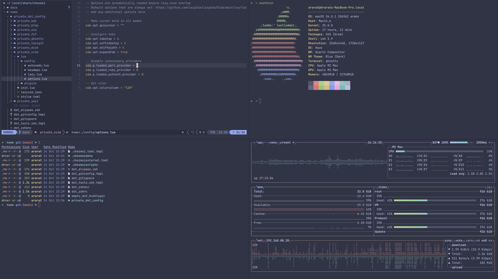

# Dotfiles

> My macOS development environment, managed with [chezmoi](https://www.chezmoi.io/).

[](https://github.com/araratpoghosyan/dotfiles/actions/workflows/ci.yml)

One theme across every terminal tool, one declarative package list, an XDG-clean home directory,
and a set of guards (template-time assertions, CI, daily drift detection) that keep the machine and
the repository from quietly diverging.



## Highlights

- **One theme, eleven choices.** Pick from Catppuccin, TokyoNight, Nord, Dracula or 0x96f once;
  bat, btop, eza, fzf, ghostty, lazygit, neovim, opencode, yazi, delta and the macOS
  appearance all follow. Only the active theme's files are deployed.
- **Declarative packages.** `packages.yaml` renders a Brewfile (2 taps, 55 formulae, 30 casks,
  1 App Store app) that `brew bundle` applies on every `chezmoi apply`. Language runtimes come
  from mise.
- **XDG-native shell.** A two-line `~/.zshenv` hands over to `~/.config/zsh`, where the
  environment, login PATH, oh-my-zsh setup and small single-purpose fragments live.
- **Guard rails.** A template-time assertion refuses to apply a broken theme registry, CI renders
  the whole tree for every theme on each push, and a daily LaunchAgent reports drift between the
  machine and the source.
- **Secrets stay in 1Password**, and 1Password is optional: leave the account empty and every
  secret-backed file is skipped.

## What's inside

| Tool | Configured as |
| --- | --- |
| [bat](https://github.com/sharkdp/bat) | Themed `cat` replacement, plain style, no paging |
| [btop](https://github.com/aristocratos/btop) | Resource monitor, themed |
| [eza](https://github.com/eza-community/eza) | `ls` replacement with icons, themed; aliases `ls`, `ll`, `la`, `lt` |
| [fzf](https://github.com/junegunn/fzf) | Fuzzy finder with eza/bat previews, colors from a themed options file |
| [ghostty](https://ghostty.org/) | Terminal, JetBrains Mono Nerd Font, themed |
| [git](https://git-scm.com/) + [delta](https://github.com/dandavison/delta) | Side-by-side diffs; light or dark follows the theme |
| [lazygit](https://github.com/jesseduffield/lazygit) | Git TUI with delta paging, theme merged into its config |
| [mise](https://mise.jdx.dev/) | Node 24.9, Go, Rust, .NET 8 and 9, Lua 5.1, and global npm tools |
| [neovim](https://neovim.io/) | [LazyVim](https://www.lazyvim.org/) with language extras; colorscheme rendered from the theme registry |
| [opencode](https://opencode.ai/) | AI coding agent, themed |
| ssh | `~/.ssh/config` pulled from 1Password (optional) |
| [yazi](https://github.com/sxyazi/yazi) | Terminal file manager, themed flavor |
| zsh | [oh-my-zsh](https://ohmyz.sh/) (git, docker, helm, kubectl, syntax highlighting), [zoxide](https://github.com/ajeetdsouza/zoxide) as `cd` |

Everything else in `packages.yaml` (Docker Desktop, JetBrains Toolbox, kubectl tooling, AWS CLI,
browsers, chat apps, fonts, and so on) is installed but not configured by this repository.

## Requirements

- macOS on Apple Silicon or Intel. The repository is macOS-only by design.
- Command Line Tools: `xcode-select --install`
- [Homebrew](https://brew.sh/). Install it, then put it on `PATH` for the current session:

  ```bash
  /bin/bash -c "$(curl -fsSL https://raw.githubusercontent.com/Homebrew/install/HEAD/install.sh)"
  eval "$(/opt/homebrew/bin/brew shellenv)"   # /usr/local/bin/brew on Intel
  ```

  Do not edit `~/.zprofile`; chezmoi manages `~/.config/zsh/.zprofile`, which loads Homebrew for
  every future login shell.
- Optional: [1Password](https://1password.com/downloads/mac/) and its CLI, signed in, with
  *Settings → Developer → Connect with 1Password CLI* enabled. Needed only for the SSH config.
- Optional: signed in to the Mac App Store, so `brew bundle` can install App Store apps. If you
  are not, those entries are skipped with a warning until you sign in and apply again.

## Install

```bash
sh -c "$(curl -fsLS get.chezmoi.io)" -- init --apply araratpoghosyan
```

That installs chezmoi, clones this repository to `~/.local/share/chezmoi`, prompts once for your
theme (from a list), name, email and 1Password account (Enter to skip), writes the answers to
`~/.config/chezmoi/chezmoi.toml`, and applies. To review before applying, drop `--apply` and run
`chezmoi diff` first.

The first apply:

1. Checks the theme registry and aborts with a precise message if anything is missing.
2. Renders every managed file, including the Brewfile and the oh-my-zsh externals.
3. Runs `brew bundle` against the rendered Brewfile, installs Claude Code, runs `mise install`,
   rebuilds the bat theme cache, applies macOS defaults, and loads the drift-check LaunchAgent.

Open a new terminal when it finishes.

## Everyday use

| Task | Command |
| --- | --- |
| Pull and apply the latest repository state | `chezmoi update` |
| Preview what an apply would change | `chezmoi diff` |
| Edit a managed file in place and apply | `chezmoi edit --apply ~/.config/zsh/.zshrc` |
| Change a personal value or the theme | edit `~/.config/chezmoi/chezmoi.toml`, then `chezmoi apply` |
| Pick the theme from the list again | delete the `theme` line, then `chezmoi init --apply` |
| Anything declared but not installed? | `brew bundle check` |
| Anything installed but not declared? | `brew bundle cleanup --dry-run` |
| Is the machine drifting from the repo? | `chezmoi-drift-check` (exit 1 means yes; see below) |
| Stop managing a file | `chezmoi forget <path>` |

## Theming

### The registry

`home/.chezmoidata/themes.yaml` is the single description of every theme:

```yaml
themes:
  catppuccin-mocha:
    light: false                   # drives delta, lazygit and macOS appearance
    description: Dark, rich pastel theme
    family: catppuccin
    bat: catppuccin-mocha          # name inside the .tmTheme file; bat selects by that, not by file name
    ghostty: Catppuccin Mocha      # name as ghostty spells it
    nvim:                          # lazy.nvim spec; the colorscheme file is rendered from this
      repo: catppuccin/nvim
      module: catppuccin
      opts: { flavour: mocha }
```

Available: `catppuccin-frappe`, `catppuccin-latte` (light), `catppuccin-macchiato`,
`catppuccin-mocha`, `tokyonight-day` (light), `tokyonight-moon`, `tokyonight-night`,
`tokyonight-storm`, `nord`, `dracula`, `0x96f`.

### How each tool gets its theme

| Mechanism | Tools |
| --- | --- |
| Theme file deployed next to the tool's config; the tool selects it by name | bat, btop, opencode, yazi |
| Theme merged into the tool's config at render time | eza, fzf, lazygit |
| Value read straight from the registry | ghostty (`ghostty`), neovim (`nvim`), delta and macOS appearance (`light`) |

Only the active theme's files reach `~/.config`. `home/.chezmoiignore` hides the other ten, and
a script removes the previous theme's files after a switch. `home/.chezmoidata/theme-assets.yaml`
records where each tool keeps its per-theme asset; the assertion, the ignore file, the prune
script and the bat cache hash all read it.

### Adding a theme

1. Add an entry to `themes.yaml` with every field shown above.
2. Add the theme's asset for each tool listed in `theme-assets.yaml`, named exactly like the
   registry key.
3. Run `chezmoi apply`. The coverage assertion fails, listing each missing asset, until every
   tool has one.

The theme picker at `chezmoi init` reads the registry, so nothing else needs updating.

## Packages

`home/.chezmoidata/packages.yaml` lists taps, formulae, casks and Mac App Store apps. It renders
to `~/.config/homebrew/Brewfile`, which `HOMEBREW_BUNDLE_FILE` points at, so `brew bundle`
commands work without `--file`. The install script runs on every apply, on purpose: if something
was uninstalled by hand, the next apply restores it. `brew bundle check` keeps the no-op case
fast.

Language runtimes are mise's job (`home/dot_config/mise/config.toml`), never Homebrew's. Claude
Code is the one tool installed by its own script, since it is not packaged for either.

## Shell

`~/.zshenv` only sets `ZDOTDIR=~/.config/zsh` and sources the `.zshenv` there. That indirection
matters: a nested shell starts with `ZDOTDIR` already set and reads `$ZDOTDIR/.zshenv` directly,
never `~/.zshenv`, so keeping the environment in `ZDOTDIR` is what makes nested shells behave like
the first one. Under `~/.config/zsh`:

| File | Purpose |
| --- | --- |
| `.zshenv` | Environment only: locale, editor, XDG directories, `FZF_DEFAULT_OPTS_FILE`, `HOMEBREW_BUNDLE_FILE`, and `typeset -U path` so PATH never accumulates duplicates |
| `.zprofile` | Login PATH: Homebrew, Docker Desktop CLI, JetBrains Toolbox, each guarded |
| `.zshrc` | oh-my-zsh, then sources `conf.d/*.zsh` in name order |
| `conf.d/10-path.zsh` | `~/.local/bin` |
| `conf.d/20-tools.zsh` | chezmoi completions, zoxide, mise, fzf key bindings and previews, eza config dir |
| `conf.d/30-aliases.zsh` | `p` (Projects), `ls`/`ll`/`la`/`lt` (eza), `vim` (nvim), `cat` (bat), `y` (yazi), `uuid` |
| `conf.d/40-drift-notice.zsh` | One-line notice when the last drift check found differences |

oh-my-zsh itself is an exact mirror of upstream (`.chezmoiexternal.toml`); the syntax-highlighting
plugin lives in `~/.config/oh-my-zsh`, and runtime caches go to `~/.cache`, so the mirror stays
pristine. Completion dumps go to `~/.cache/zsh`.

## Secrets

The only secret-backed file is `~/.ssh/config`, read from the *Dotfiles* vault with
`onepasswordRead`. It is rendered only when `onePasswordAccount` is set in
`~/.config/chezmoi/chezmoi.toml`; when empty, `.chezmoiignore` skips it and chezmoi never calls
the 1Password CLI. To add another secret-backed file, add its target to the same block in
`home/.chezmoiignore`.

Headless machines can use a 1Password service account: set `[onepassword] mode = "service"` in
the chezmoi config and export `OP_SERVICE_ACCOUNT_TOKEN`. On a trusted personal machine,
`[onepassword] prompt = false` removes the confirmation prompt.

## Guard rails

### Scripts, in execution order

| Script | Runs | Does |
| --- | --- | --- |
| `run_before_00-assert-theme-coverage` | every apply, before files | Template-only. Renders to nothing when the registry is consistent; otherwise `fail` aborts the apply before anything is written |
| `run_after_10-install-packages` | every apply | `brew bundle check`, then `brew bundle install` if needed; App Store entries may fail without failing the apply |
| `run_after_20-install-claude-code` | every apply, exits at once when installed | Official installer, stable channel, downloaded to a file before it runs |
| `run_onchange_after_30-mise-install` | when mise config changes | `mise install` |
| `run_onchange_after_40-bat-rebuild-cache` | when bat config or the active theme changes | `bat cache --build` |
| `run_onchange_after_50-prune-inactive-themes` | when the theme or registry changes | Removes the previous theme's files |
| `run_onchange_after_60-configure-macos-defaults` | when its content changes | Finder, Dock, Terminal, screenshots; restarts Finder and Dock |
| `run_onchange_after_65-macos-appearance` | when the theme's light/dark flag changes | Light or dark system appearance |
| `run_onchange_after_70-load-drift-check-agent` | when the plist changes | Loads the drift-check LaunchAgent and runs the first check |

### Theme assertion

Before any file is written, the assertion checks that the selected theme is registered, that
every registered theme has an asset for every tool in `theme-assets.yaml` plus the `bat`,
`ghostty` and `nvim` fields, and that no tool directory holds an asset for an unregistered
theme. Failure looks like:

```
chezmoi: template: ... error calling fail: theme registry has themes without assets (theme / tool / expected path)

  - my-new-theme           bat       dot_config/bat/themes/my-new-theme.tmTheme
  - my-new-theme           yazi      dot_config/yazi/flavors/my-new-theme.yazi/flavor.toml
```

### Continuous integration

`.github/workflows/ci.yml` renders the tree once per theme on a Linux runner into a scratch
directory: apply, verify, render every script and check it with `bash -n` and shellcheck,
syntax-check the rendered zsh and Lua. A single macOS job repeats the apply and parses the
Brewfile with `brew bundle list`. Scripts never execute, externals are skipped, and no 1Password
account is configured, so CI needs no secrets and touches no real machine.

### Drift detection

The LaunchAgent `io.chezmoi.drift-check` runs `~/.local/bin/chezmoi-drift-check` daily at 10:00
(or at the next wake). It runs `chezmoi status` over every managed target except `~/.ssh`, so it
never prompts for 1Password, and catches both local edits that never reached the repository and
pulled changes not yet applied. On drift it posts a notification, writes the list to
`~/.cache/chezmoi/drift`, and the next shell prints a one-line notice. The shell cost is a single
file test; the check itself never runs in the shell.

## Repository layout

```text
~/.local/share/chezmoi/
├── .github/workflows/ci.yml       # CI (see Guard rails)
├── docs/                          # Screenshot
├── home/                          # chezmoi source root (.chezmoiroot)
│   ├── .chezmoi.toml.tmpl         # Prompts once; writes ~/.config/chezmoi/chezmoi.toml
│   ├── .chezmoidata/
│   │   ├── packages.yaml          # Taps, formulae, casks, App Store apps
│   │   ├── theme-assets.yaml      # Where each tool keeps its per-theme asset
│   │   └── themes.yaml            # Theme registry
│   ├── .chezmoiexternal.toml      # oh-my-zsh (rolling mirror), zsh-syntax-highlighting (pinned)
│   ├── .chezmoiignore             # Hides inactive themes; skips secret-backed files without 1Password
│   ├── .chezmoiremove             # Old targets removed on apply
│   ├── .chezmoiscripts/           # Numbered scripts (see Guard rails)
│   ├── .chezmoitemplates/themes/  # eza, fzf, lazygit theme inputs (merged, never deployed)
│   ├── .chezmoiversion            # Minimum chezmoi version
│   ├── dot_config/                # ~/.config: bat, btop, eza, fzf, ghostty, homebrew, lazygit,
│   │                              #   mise, nvim, opencode, yazi, zsh
│   ├── dot_gitconfig.tmpl         # git + delta
│   ├── dot_gitignore              # Global gitignore
│   ├── dot_local/bin/             # chezmoi-drift-check
│   ├── dot_zshenv                 # Bootstrap: sets ZDOTDIR, sources ~/.config/zsh/.zshenv
│   ├── empty_dot_hushlogin        # Silences the login banner
│   ├── private_Library/LaunchAgents/  # io.chezmoi.drift-check.plist
│   └── private_dot_ssh/           # SSH config from 1Password (optional)
└── README.md
```

Conventions: data files under `.chezmoidata` describe *what*, templates describe *how*, scripts
describe *when*. Only `~/.ssh` and `~/Library` carry the `private_` attribute; they are the
directories macOS itself keeps at 0700.

## Troubleshooting

**Apply asks "has changed since chezmoi last wrote it".** A managed file was edited outside the
repository. `diff` shows what differs; `overwrite` takes the repository version; `skip` keeps the
local one, after which `chezmoi add <path>` brings the edit into the repository.

**The theme did not change everywhere.** Run `chezmoi apply -v` and open a new terminal (`exec
zsh`). bat needs its cache rebuilt, which the apply does automatically; `bat cache --build` forces
it.

**A package is not installing.** The install script runs on every apply; `chezmoi apply -v` shows
brew's output. If an `onchange` script is stuck in a bad recorded state:
`chezmoi state delete-bucket --bucket=scriptState`, then apply again.

**No drift notification appears.** macOS asks once whether osascript may send notifications, on
the first check after install. If it was dismissed: System Settings → Notifications → Script Editor
(or osascript) → Allow. The shell notice works regardless.

**The drift notice keeps appearing.** It reflects the last daily check. After reconciling with
`chezmoi apply` or `chezmoi add`, run `chezmoi-drift-check` to clear it. Inspect the agent with
`launchctl print gui/$(id -u)/io.chezmoi.drift-check`; its log is `~/.cache/chezmoi/drift-check.log`.

**`chezmoi diff` hangs.** With a 1Password account configured, rendering `~/.ssh/config` waits for
the CLI to authorize. Approve the prompt, or diff specific paths: `chezmoi diff ~/.config`.

**1Password CLI errors.** `op account list` shows whether you are signed in; `op signin` fixes it.
Biometric unlock must be enabled in *Settings → Developer*. To stop using 1Password entirely,
empty `onePasswordAccount` in the chezmoi config.

## Acknowledgments

[chezmoi](https://www.chezmoi.io/) · [LazyVim](https://www.lazyvim.org/) · [oh-my-zsh](https://ohmyz.sh/) ·
[Catppuccin](https://catppuccin.com/) · [TokyoNight](https://github.com/folke/tokyonight.nvim) ·
[Nord](https://www.nordtheme.com/) · [Dracula](https://draculatheme.com/) ·
[0x96f](https://github.com/filipjanevski/0x96f.nvim)

Personal dotfiles. Take whatever is useful.
